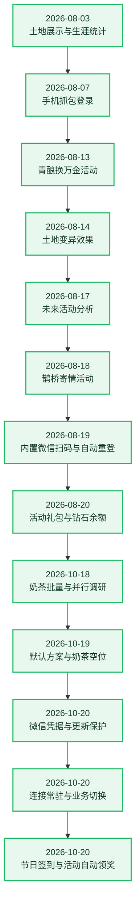

# 🌱 农场成长记录

[← 返回项目首页](../README.md)

这里记录 QQ Farm Bot 已完成的重要功能和改进。最新记录在最前面。

## 更新流水图

## 详细记录

### 2026-10-30 · 黄金·森野柿子识别

- 新增“黄金·森野柿子”的背包识别、金豆豆售价和专属图标。

### 2026-10-30 · 奶茶可选自动化

- 新增默认关闭的活动种子自动补购、已有班次互动与工资领取、店铺自动升级，支持独立目标、库存、保留量和每日预算；账号与默认方案均可保存。

### 2026-10-30 · issue 自动化需求交付规则修正

- 已确认的手动活动操作可按独立开关、预算、调度与去重要求提供可选自动化，消耗策略默认关闭；未知协议的证据要求保留。
- issue 逐项区分可交付部分与具体阻塞，避免只修关联小项后长期搁置用户需求；未完成内容继续保留，修复验证后才回复已解决。

### 2026-10-29 · 奶茶新奖励识别

- 新增识别奶茶活动限定装扮“金露云酪”与黄金果实“黄金·森野可可豆”，并随登记交付两张经核验的专属物品图。

### 2026-10-29 · 治理拒绝与协议序号隔离

- 内部请求编号与实际协议序号分别管理；被治理器拒绝，或在发送前取消、准备超时的请求不再占用协议序号。
- 只在开始发送时提交协议序号，保留原有心跳放行、业务预算、超时与连接切换保护。

### 2026-10-28 · 请求超时与连接切换保护

- 请求准备与等待回复共用原有超时预算，准备超时后停止发送，停止账号时也会取消仍在编码中的请求。
- 请求绑定原连接；连接切换后的旧请求、迟到回包和旧连接事件不再影响新连接的心跳状态。

### 2026-10-27 · 宣传喇叭最大用量

- 喇叭数量旁新增“最大”，按已确认库存一键选择本次可用数量，保留手动调整和使用前确认。
- 库存未知、耗尽或活动结算时禁用；数量和库存变化会撤销旧确认，避免提交过时的消耗。

### 2026-10-26 · 连续成熟地块合并补种

- 新增连续成熟地块合并补种，逐块到点收获后统一确认土地并补种。

### 2026-10-26 · GitHub 反馈回复与后续关闭

- 自动修复回复先感谢反馈，再说明修复和更新方式，最后欢迎继续反馈；仍需验证修复已发布，重复检查不重复回复。
- 新增可选的回复后 7 天无跟进自动关闭规则，支持维护者人工回复；有用户新留言、评论编辑或问题内容更新时继续保留，关闭前核对最新远端状态。

### 2026-10-24 · 收种结束后普通巡田恢复

- 修复收种任务结束后，后续巡田定时器沿用旧权限标记而反复报错的问题。普通巡田恢复正常，静默期间的自家收种优先规则和迟到请求保护保持。

### 2026-10-24 · 黄金·森野甜橙识别与专属图标

- 新增黄金·森野甜橙的背包识别、金豆豆售价展示与专属图标。

### 2026-10-24 · 静默收种优先、常驻连接提示与天山红枫识别

- 自己的成熟收获与收后补种优先于静默，完成后继续原静默时段；偷菜、帮助和重点好友仍暂停，连接心跳保留。
- 补种后接续下一茬成熟日程；多季作物继续生长，未知地块不铲除，失败保留待办并受控重试，出售与施肥等常规操作到静默结束后再处理。
- 更新时明确显示接管已有农场连接，初次昵称读取不再显示 `None`，相同保活设置不重复提示。
- 补齐天山红枫种子与果实的名称、专属图片和单格种植识别，出售继续遵守原有果实资格规则。

### 2026-10-22 · 奶茶互动提示与奖励资源补齐

- 班次互动提前显示完成状态、次数和不可用原因，确认期间状态变化会撤销旧操作；成功后展示已确认奖励的名称与数量。
- 补齐奶茶套餐装扮、部分基金奖励和黄金·森野红柚的名称与专属图片。

### 2026-10-22 · 每日静默覆盖自动任务

- 每日静默时段统一暂停自动农场、偷菜、帮助、捣乱、重点巡查与相关定时任务，覆盖排队推送及任务间状态复查；保留连接心跳和手动查询，到点自动恢复。

### 2026-10-22 · 每日静默固定北京时间

- 每日静默起止时间明确按北京时间（UTC+8）判断，服务器运行在 UTC 或其他时区时也按所选钟点生效；已有时间设置无需手动换算。
- 账号策略和默认方案显示时区说明，保留跨午夜时段、起始包含与结束不包含、起止相同全天静默的既有规则。静默的业务范围与连接心跳保持原有行为。

### 2026-10-21 · 修正自己农场催熟误报

- 自然成熟、收获后计数重置、换季和同种补种不再误报“检测到催熟/化肥”；空地、枯株和成功收获会清理旧作物基线。
- 保留连续生长期间真实成熟时间提前、施肥余次下降与催熟状态变化的识别，日志记录对应地块和判定原因。兼容业务热交接，原有成熟计时与到点收获保持。

### 2026-10-21 · 修复常驻业务同步等待竞态

- 修正好友巡田、状态同步和在线捣乱共用的进程间等待：前一次回复的迟到唤醒不会再把下一次正常读取误判为控制通道失效。
- 每次操作仍只发送一次，等待实际回复并共享原有总超时；不靠关闭捣乱、降低频率或反复重建业务处理这类误报，连接与操作权限检查保持。
- 真实异常补充安全原因、等待耗时、唤醒次数与完成状态，便于后续进化区分线程竞态、真正超时和协议异常。

### 2026-10-21 · 业务异常恢复保留连接

- 常驻业务遇到控制链或会话代次异常时停止继续派发，保留首个故障的安全诊断；运行中的业务错误与启动失败分别记录，避免旧任务持续产生重复报错。
- 对已确认退役的业务自动进行有限重试，只替换业务并保留原游戏连接、心跳及登录时间。控制通道重接也沿用原宿主，账号停止、改绑或管理退出会撤销旧恢复任务。
- 旧宿主尚未确认业务故障时显示待恢复，等待后续自然事件确认；不会把旧就绪快照当成已经修复，也不会为恢复主动断开游戏连接。

### 2026-10-21 · 每日分享奖励解析与重复保护

- 修正通用每日分享的上报结果及奖励列表解析，不再要求接口没有返回的成功标记；与活动内的快乐值分享奖励分别处理。
- 日志区分资格检查、分享上报和奖励领取阶段。请求已提交但解析失败、超时或未确认奖励时，保留当天声明，更新、重启及强制检查都不会自动重复提交；只在奖励列表确认后显示领取成功。

### 2026-10-20 · 运行日志跨更新保留

- 运行日志与账号操作日志保存在本机，管理进程更新后回填最近历史并保留原时间；条数与容量均设上限，避免运行越久占用越大。
- 手动清空指定账号或全部日志后，重新加载不会恢复已清空内容。历史读取或保存异常不会触发账号重启或重新登录。
- 管理日志重新加载与游戏连接分开判断。静默保留连接心跳，兼容的管理与业务更新接管常驻连接；不会把管理接管时间当成新的游戏登录时间。

### 2026-10-20 · 节日签到与活动自动领奖

- 新增独立节日签到与节令日历入口，可查询当期种子等奖励、领取签到奖励、手动选择节令答案及领取合格季度奖励；已领、错项和到期状态在操作前复核。
- 补齐茱萸种子、单格植物和果实映射，背包不再把这颗已核验种子标为占地待确认；真正缺映射的种子仍保留未知状态。
- 在“自动控制”中独立开启“奶茶自动领奖”，收银台按服务端累计营业时间确认满额再自动领取；预计满额时间用于到点复查，已有少量收益不再被当成满额。快乐值补齐首次分享奖励，并自动领取合格每日、首次分享与档位奖励；关闭普通自动任务不影响活动领奖，未知结果跨更新和重启保留重复保护。
- 雇佣查询提前过滤不可雇员工，核对状态与两种冷却；候选刷新、失败或换班次会撤销旧确认，提交前再次复核资格。
- 手动静默继续暂停自动动作；商店等请求的全局拦截仅在重点防护期间生效。关闭重点防护不清除手动静默时间，连接心跳保留，兼容常驻连接上的业务切换。
- 自进化同时检查独立玩法入口和可自动化的免费收益，按用户流程规划改进；验证后主动修正对应专题 skill，合并旧经验和过时规则，后续进化需细读相关专题。

### 2026-10-20 · 连接常驻与业务切换

- 已验收的 Linux 管理运行区由独立进程持有游戏连接；管理页面和兼容的业务版本更新可接管原连接，减少更新后因旧授权无法重新登录造成的掉线。
- 切换前暂停新任务并等待在途操作收口，交接种植、活动、好友额度、统计和原定时任务；已发送但结果不明的操作不会自动重做。准备失败时保留可恢复的原业务，并清理本次交接保护。
- 账号状态分别展示管理、连接和业务版本。首次从旧运行方式迁移需要一次重连；账号停止、重新扫码换代、上游撤销授权或连接协议不兼容时仍可能重连或需要重新扫码。
- 扫码检查点依据实际游戏登录及所用授权更新，管理进程接管时间不会被算成新的登录时间。奶茶批量制作精确保留各组水果标识，避免大数转换导致材料不匹配。

### 2026-10-20 · 更新日志与后续进化

- 登录页更新日志直接展示这份成长记录的详细章节，发布后同步更新，保留原有历史记录。
- 后续进化继续按问题反馈和活动版本变化迭代，优先对照近期更新且超过 20 星的项目，并核实官方公告、单次与批量操作、材料确认和结果刷新；已交付的功能按日期记录，未验证的能力不冒充完成。

### 2026-10-20 · 微信凭据与更新保护

- 微信令牌刷新后立即保存，后续登录凭据获取失败不会误报整次续期成功；当前农场连接与重新登录的凭据状态分别显示。
- 仅测试、文档变化且生产内容与权限一致时保留当前进程；必须重启时预先准备一次性登录交接，启动前复验账号、授权与有效期。
- 已失效授权仍需重新扫码，24 小时仅是提醒参考；连接常驻与业务热更新尚未上线。

### 2026-10-19 · 默认方案与奶茶雇佣空位

- 修复默认方案中静默时段开关保存后恢复关闭的问题，同时保留同次编辑的策略与自动化设置。
- 奶茶雇佣按店铺等级开放的容量计算空位，兼容接口只返回已占用班次的情况；已结束班次释放空位，未知状态与满员分别提示。

### 2026-10-18 · 并行研究委派

- 主 Agent 可按需并行委派 GitHub 调研和辅助取证，只读任务不再消耗首次实施机会；主 Agent 继续决定方案、采纳及最终验收。

### 2026-10-18 · 奶茶批量制作

- 工坊支持多选、按配方全选和一键制作全部，确认整组材料数量后一次提交；材料变化需重新确认。进化优先对照近期更新且超过20星的项目，并逐项检查批量玩法与结果刷新。

### 2026-10-16 · 活动界面与专属图片

新增奶茶券、宣传喇叭与本期装扮奖励的专属图片及物品名称。

活动玩法改为分区卡片，统一按钮、表单、手机布局和确认操作；补齐本期种子、果实图片，核验后的专属资源随进化自动交付。

### 2026-10-15 · 奶茶首屏真实状态

修复活动库存读取，首屏一次加载收银台、工坊与工作状态，明确显示空班次和未解锁资格。

### 2026-10-15 · 验收通知与自动应用

协作验收通过先通知，再自动应用并确认就绪；运行区权限与实际通过验证的任务区保持一致。

新增奶茶热销中活动面板、显式玩法查询与确认式手动操作，并下架上一期活动入口。

### 2026-10-15 · 主 Agent 连续修复与逐轮记忆

子 Agent 仅首次实施，后续由主 Agent 直接修正和验证，逐轮保留原因、改动与待办，恢复时沿用原任务记忆。

### 2026-10-15 · 主 Agent 持续统筹进化

主 Agent 在同一会话中调用子 Agent 工具、检查并修正结果，统一验收后通知；保留原任务合同和草稿恢复。

### 2026-10-15 · 活动发现即时进化

新活动与结束活动发现后独立排队，空闲时立即进化，同批去重且不占每日巡检名额。活动恢复沿用原任务与计划，版本及玩法变化时复核现有接口、错误和推送证据。

### 2026-10-14 · 官方公告只读查询

新增小游戏官方公告列表及正文手动只读查询，复用缓存并保留活动进化参考快照。

### 2026-10-13 · 好友摘要退避与警告聚合

新增好友摘要共享退避、到点目标缓存派发、读取生命周期隔离与通信预算警告聚合；修复活动到期计时提前触发后的重排与旧回调保护。

### 2026-10-13 · 审批实施指令与续跑交接

新增主 Agent 可执行审批指令与完整续跑交接；已被新批准取代的旧意见不再混入失败通知。

### 2026-10-09 · 活动清理与进化进度

新增过期活动自动移除、活动进化计划恢复与真实复核进度展示。

### 2026-10-09 · 活动截止与重启排队回执

新增活动下架与截止守卫、显式重新检查恢复，以及账号重启排队回执。

### 2026-10-09 · 巡检经验自动复用

新增巡检阶段独立会话与已验收经验自动生成、复用私有技能。

### 2026-10-07 · 进化隔离候选发布与应用加固

- 进化候选在独立任务工作区构建发布（隐私扫描/远端漂移核对/非强制推送），应用切换到干净运行时工作区并完整校验启动上下文；已审提交可重复应用（重启退回后自动复用运行时区）。

### 2026-10-02 · Bark 推送改为纯二维码图片

- 所有微信重扫 Bark 推送只携带一张当次生成的二维码图片（无标题、正文仅一个空白字符），自动提前/失效提醒到点即推新码且不取消进行中的扫码会话；二维码 PNG/JPEG 按魔数嗅探原样输出（修复上游返回 JPEG 被拒的线上故障）。

### 2026-10-02 · 微信凭据失效 Bark 提醒与自助重扫

- 新增可选 Bark 失效提醒（默认关闭，用户自助配置）：既有微信凭据被确认失效时每代次至多推一条，用户点开链接自行发送新二维码到自己的设备完成重扫保存，管理员无需代发。

### 2026-10-02 · 微信扫码维护参考计划提前提醒

- 新增可选「扫码维护参考计划」：以最近一次真实成功扫码为基线，按用户自设周期（默认 24h）在到期前（默认 60 分钟）通过用户自己的 Bark 提前提醒准备重扫；仅当最近 24h 观察到「已在其他终端登录」踢下线记录（手机进场参考）时发送，无信号保持安静，与失效提醒合计同次扫码至多一条自动提醒，成功重扫后开始下一轮。

### 2026-10-01 · GitHub issue 反馈自动回复

- 新增可选 GitHub issue 反馈路由（owner 私有配置，默认关闭）：后台采集自有仓库开放 issue，修复发布后按报告指纹核对并以简洁更新模板回复，全程发布/送达/伪造标记多重校验，未验证绝不回复。

### 2026-08-20 · 活动礼包与钻石余额

- 道具商城新增鹊桥寄情礼包、千星每日礼包和两档千星礼包，支持展示折扣、每日/活动限购数量及已购进度。
- 按官方商品数据区分购买货币：`1027`、`1028` 使用钻石，`1029` 使用点券；商品卡、余额判断和购买确认文案保持一致。
- 活动商品按服务端结束时间过滤，页面停留期间到期也会自动隐藏，无需手动刷新。
- 道具商城支持自动发现后续活动商品：官方响应中带活动标记或截止时间的新商品无需预置 ID 即可展示，普通常规商品仍按既有范围过滤。
- 修正新版道具商城协议的商品列表、价格货币、折扣、限购和活动截止时间字段，兼容已售罄商品的响应形式。
- 新增钻石余额读取与实时状态同步；商城顶部和概况资源卡现可展示钻石余额。
- 手动填码支持直接粘贴官方 WebSocket 完整 URL：自动提取 `code`、`platform` 和 `ver`，并在保存账号时校准系统客户端版本。
- 补充商城价格货币与限购协议测试，并通过前端类型检查和生产构建。

### 2026-08-19 · 内置微信扫码、版本同步与运行自愈

- 移植进程内应用宝登录协议：通过微信 OAuth 扫码取得会话，再由内置 MMTLS 协议换取农场微信小游戏 Code，不再要求额外部署 YYB-GO 或第三方登录服务。
- “添加账号”开放微信扫码标签；进入标签后自动获取二维码，二维码空态和按钮均可手动获取或刷新。
- 修复扫码请求未携带面板登录 Token、后端无法识别当前用户的问题；扫码会话按当前用户隔离，避免多用户之间串用凭证。
- 微信扫码账号持久化 `loginBuffer`、`refreshtoken` 和 `accesstoken`，账号列表接口不向浏览器返回这些敏感字段。
- 扫码添加成功后默认启动账号，并自动开启“自动刷新获取 Code”，默认间隔为 60 分钟；已有内置凭证的旧微信账号会执行一次默认配置迁移。
- 每 30 分钟主动滚动保活应用宝凭证；手动启动、程序启动和定时刷新会优先通过内置协议获取新 Code，成功后更新账号并重启 Worker。
- 账号被踢或 WebSocket 多次重连失败后，可按自动刷新间隔延迟重登，并保留防止旧 Code 循环重连的停止行为。
- 保留外部微信登录 API 作为旧账号兼容回退；具备 `loginBuffer` 的新扫码账号不会回落到外部 API。默认不要求代理池，若网络环境确需代理，应使用账号固定出口而非随机轮换。
- 接入 WebSocket 服务端版本自动校准：登录回包和心跳回包会检查 `version_force`、`version_recommend`，优先采用强制版本并将完整客户端版本持久化到系统配置。
- Worker 检测到版本变化后上报主进程，主进程同步更新运行时和配置文件，后续 WebSocket URL、登录请求及心跳请求使用新版本。
- 已完成微信二维码在线生成验证、前端类型检查与生产构建；完整凭证生命周期仍需持续运行观察，凭证被撤销或过期时需重新扫码。
- 微信账号 WebSocket 登录返回 400 时接入内置应用宝刷新链路，刷新凭据和农场 Code 后自动重启账号；同账号同时触发的刷新会合并，避免滚动 Token 并发覆盖。
- 增加 Worker 看门狗：每 30 秒探测、90 秒无响应自动重启；一小时内最多自动重启 3 次，超限后停止账号。
- 增加自动恢复熔断：单账号每日最多 8 次恢复，连续刷新失败 3 次后停止自动尝试，成功恢复会清零连续失败计数。
- 账号接口不再接受客户端直接提交 `loginBuffer`、Refresh Token 或 Access Token；更换 `wxid` 时自动清空旧凭据，只有与当前面板用户绑定的有效扫码会话可以写入新凭据。
- 本次未包含业务请求合并、心跳请求容量预留和资源包完整性校验；这些运行质量优化仍属于后续范围。

### 2026-08-18 · 鹊桥寄情活动

- 支持自动使用、自动构建和自动指定好友赠送。
- 当前功能尚未完成全面测试。

### 2026-08-17 · 未来活动分析

- 活动页新增未来活动分析功能。
- 活动正式接入仍需要采集对应数据。

### 2026-08-14 · 土地变异效果

- “个人 → 我的农场 → 土地详情”新增作物变异效果展示，支持黄金、冰冻、爱心、暗化和湿润效果。
- 根据官方 `mutant_effect_plant` 配置映射变异作物，黄金变异可展示对应的金色植物贴图，并兼容多种变异组合。
- 暗化效果使用官方烟雾和粒子素材；其余效果结合对应作物显示金色辉光、冰晶、爱心和下落水滴动画。
- 所有变异动画限制在当前作物区域内，并调整作物锚点，使作物及特效更贴近菱形土地的视觉中心。
- 土地详情展示变异效果的实际作用，例如售价倍数、产量倍数或黄金果实产出。

### 2026-08-13 · 青酿换万金活动

- 新增活动页面。
- “自动控制 → 活动控制”中新增自动开关。

### 2026-08-07 · 手机抓包登录

- 内置纯 Node.js 抓包服务，默认嵌入 Bot 进程，无需单独启动服务或端口。
- 手机设置 Wi-Fi 代理后打开 QQ 农场，即可自动获取登录 Code 并添加账号。
- 支持多 IP 公布、局域网和 Tailscale 组网，面板可根据网络环境选择地址。
- 获取 Code 的同时解析好友 GID，并在后台同步 QQ 平台好友列表。
- 详细步骤见[抓包登录服务手册](../core/docs/capture-service.md)。

### 2026-08-03 · 土地展示重做

- 参考游戏内农场布局，实现等距视角土地展示。
- 完善普通作物各生长阶段图片。
- 完善四格作物展示，并使用官方资源生成对应图片。
- 新增土地资源图片更新指令。

### 2026-08-03 · 生涯统计与体验优化

- 点击头像即可查看生涯统计。
- 新增神秘商人自动购买开关。
- 修复每日任务进度展示错误。
- 修复种子获取策略问题。

### 2026-08-03 · 心许千灯星垂野活动

- 新增活动页面，可查看活动进度、星砂余额和奖励状态。
- 支持“观星礼录”奖励领取与“星砂兑换商店”奖励批量兑换。
- 支持领取“千星游记”阶段奖励和“节令小札”节令奖励。
- 新增“千星游记”和“观星礼录”自动领取选项，每 5 分钟检查一次。
- 补充活动作物、种子、装扮等奖励配置及活动专属图片资源。

### 2026-08-03 · TSDK/WASM 协议更新

- TSDK/WASM 升级至官方 `v3.8.6.1785240280`，适配新版运行时、数据段解密和完整性校验。
- 更新默认 WASM 文件及 SHA-256 校验，确保网关 Token、ACE 心跳和多账号运行正常。
- 新增 TSDK/WASM 更新检查工具，可比较版本、导入导出、数据段和关键运行参数。
- 补充标准更新、验证与回退流程。

### 2026-08-03 · 2×2 作物种植

- 修复活动四格作物“星语铃花”的占地配置，背包中增加 2×2 标识。
- 优化四格作物土地预留策略，优先选择已清空土地更多的区域。
- 收获后土地状态不明确时不再自动铲除，避免误铲仍在生长或进入下一季的四格作物。
- 补充土地展示、活动作物配置和 2×2 种植预留测试。
# 2026-10-16

- 策略设置增加默认关闭的“重点防护”：空闲休息时暂停业务请求，保留连接维护，到点恢复；补齐推送与排队动作的暂停检查。每次最短、最长休息分钟数可配置，移除隐藏的十分钟上限，保留已知成熟与提前观察窗口约束。
- 活动商城支持逐商品兑换数量、剩余限购与当前最大可兑数；确认前显示精确总消耗，提交仍由服务端复核，兑换后刷新余量。
